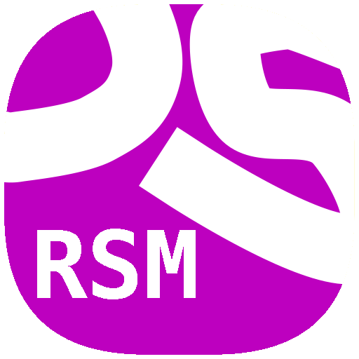
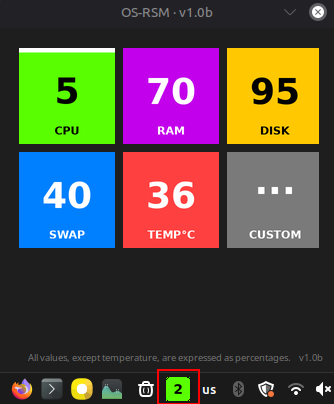

# OS-RSM

Open Source Resource System Monitor - это программа для отслеживания температуры и уровня использования ресурсов: процессора, оперативной памяти, файла подкачки и диска. Она также отображает выбранные данные в системном трее операционной системы.

> **Разные языки / Other Languages:** [English](README.md) • [Русский](README.ru.md)

         

---

##  Скачивание

**[Download OSRSM (Releases page)](https://github.com/MihanPROJECTS/OS-RSM/releases)**
- **Linux** - `OSRSM`

> [!IMPORTANT]
> Если вам понравился проект, то поставьте звезду - это поможет дальше развивать программу.🌠

##  Available functions
Нажмите на небольшой квадрат в области уведомлений (системном трее) вашей операционной системы. Откроется окно, позволяющее выбрать блоки для трея. Выберите нужный блок из списка - он будет добавлен в область уведомлений; после этого программу можно закрыть, и она продолжит работать в фоновом режиме.

###  БЛОКИ
* **`CPU usage % (GREEN)`**
* **`RAM usage % (VIOLET)`**
* **`DISK usage % (YELLOW)`**
* **`SWAP usage % (BLUE)`**
* **`TEMPERATURE °C / °F (RED)`** 
* **`CUSTOM (GREY)`**
